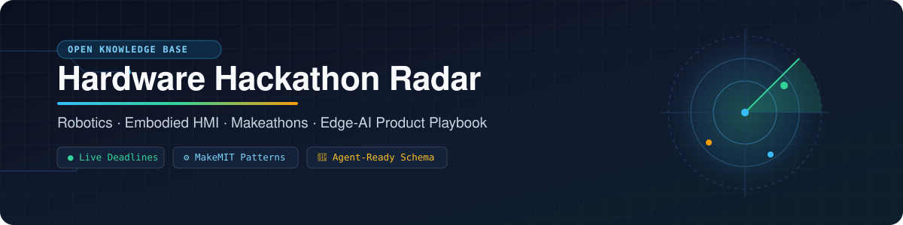

<div align="center">



<br />
<br />

[](data/hackathons.json)
[](data/hackathons.json)
[](AGENTS.md)
[](LICENSE)
[](CONTRIBUTING.md)

**追踪全球硬件、机器人与具身交互黑客松的开源雷达**  
为**硬件创造者**与 **AI Research Agents** 共建而设计 · 拒绝纯刷榜思维，聚焦物理世界的产品叙事

[⚡ 本周可报名雷达](#-一当前可报名--即将开放雷达截至-2026-11-19) · [🏛️ MakeMIT 标杆库](#-二行业标杆赛事核验档案makemit-对标全览) · [💡 具身产品提案](docs/project-proposals.md) · [🤖 Agent 续研协议](AGENTS.md) · [🤝 参与维护](CONTRIBUTING.md)

</div>

---

> [!TIP]
> **为什么做这个仓库？**  
> 好的硬件黑客松（如 MakeMIT、CMU Build18、地瓜黑客松）不是在比谁把大模型参数调大，而是在比**如何用端侧低延迟感知 + 确定性机构，讲出一个 15 秒就能打动人的物理产品故事**。  
> 本仓库同时服务**人**与 **AI Agent**：结构化数据存在 [`data/hackathons.json`](data/hackathons.json)，所有 Agent 协作规范写在 [`AGENTS.md`](AGENTS.md)，PR 自动触发校验。

---

## ⚡ 一、当前可报名 / 即将开放雷达（截至 `2026-11-19`）

### 🇨🇳 国内赛事（线下真机 & 线上开源硬件）

| 状态 | 赛事名称 | 形式 / 地点 | 赛期 | 报名截止 | 亮点与硬条件 |
| :--- | :--- | :--- | :--- | :--- | :--- |
| 🟠 **最后窗口** | **[地瓜机器人黑客松 2026](https://hackathon.d-robotics.cc/)** | 线下 · 上海张江 | `12.05 — 12.07` | **`11.30`** | **强推**：现场提供 RDK、机器狗/机械臂、深度相机、3D 打印；¥300k 奖池，包国内交通食宿 *(注：官网按钮加载中，请走官方公众号/合作社区入口)* |
| 🟠 **最后一周** | **[立创开源七周年硬件赛](https://oshwhub.com/activities/seventh)** | 线上 · 立创开源 | `09.22 — 11.25` | 报名 **`11.24`**<br>交稿 `11.25` | 需使用嘉立创 EDA 专业版并开源，送元件券 / 3D 打印券 / 机械键盘 |
| 🟢 **开放中** | **[立创 × 博通 BK7258 挑战赛](https://oshwhub.com/activities/bk7258)** | 线上 · 立创开源 | `11.10 — 12.31` | **`12.31`** | 基于 BK7258 模组开发创意硬件，发耗材/PCB 券，最高 ¥2,000 京东 E 卡 |
| 🟢 **开放中** | **[绿联 AI NAS 黑客松](https://hackathon.ugnas.com/)** | 线上 + 远程实机 | `11.09 — 01.09` | 初赛 **`12.07`** | 主打 AI Skill 与私有数据自动化；25 强提供远程真实 AI NAS，¥34k 奖池 |

### 🌍 海外 / 全球赛事（线上硬件挑战 & 北美线下）

| 状态 | 赛事名称 | 形式 / 地点 | 赛期 | 报名窗口 | 亮点与门槛 |
| :--- | :--- | :--- | :--- | :--- | :--- |
| 🟢 **开放中** | **[Autodesk AU 2027 Product](https://www.hackster.io/contests/autodesk-university-2027-product)** | 全球线上 · Hackster | 截止 `12.21` | **`2026.12.21`** | Fusion + Arduino UNO Q 造随身智能硬件，发板卡与 $300 PCBWay 券，冠军可量产 750 台 |
| 🟢 **开放中** | **[Emotion in Motion](https://www.hackster.io/contests/emotion-in-motion)** | 全球线上 · Hackster | 截止 `27.06.28` | **`2027.06.28`** | Arduino UNO R4 WiFi 情感/动作交互机器人（送 500 块板子，极契合 HMI） |
| 🟢 **开放中** | **[Infineon Boss Battle](https://www.hackster.io/contests/infineon-boss-battle)** | 全球线上 · Hackster | 截止 `27.01.04` | **`2027.01.04`** | PSOC Edge E84 端侧语音 / 雷达手势 AI |
| 🟢 **开放中** | **[Agentware AI Agent Hackathon](https://agentwarehack.com/)** | 全球线上 · Discord | `11.27 — 11.30` | 赛前 Discord 组队 | 纯软件 72h，主打无人值守执行与 Prompt 注入安全防线 |
| 🟡 **明日开启** | **[MIT Reality Hack 2027](https://www.realityhackatmit.com/)** | 线下 · MIT 剑桥 | `27.01.28 — 02.01` | **`2026.11.20`** 开启 | 全球 XR / 穿戴硬件 / 空间交互天花板，面向全球筛选 |
| 🟢 **开放中** | **[TreeHacks 2027](https://treehacks.com/)** | 线下 · 斯坦福 | `27.02.12 — 02.14` | 已开放（登录可见截止） | 36h 千人旗舰黑客松，主要面向高校学生 |
| 🟢 **开放中** | **[Hack K-State 2026](https://hackkstate.tech/)** | 线下 · 美国堪萨斯 | `12.04 — 12.06` | 开放中 | MLH 赛季赛事，限美国高中及高校学生 |

---

## 🏛️ 二、行业标杆赛事核验档案（MakeMIT 对标全览）

> [!NOTE]
> 这些殿堂级赛事是寻找**硬件产品叙事、低成本物理交互脑洞与工程原型结构**的黄金参照系。以下均按 `2026-11-19` 官方现状核验：

| 赛事 | 风格标签 | 赛期 & 当前状态 | 最值得学习的点 |
| :--- | :--- | :--- | :--- |
| **[MakeMIT](https://makemit.org/)** | `MIT` · `Makeathon` | 春季赛期；官网当前返回 403，无开放入口 | **“物理强制力 × 幽默感”** 典范（如躲猫猫戒手机车、真粉笔黑板手） |
| **[Build18 (CMU ECE)](https://www.build18.org/)** | `CMU` · `极客车库` | `2027.01` 春季首周（限含 CMU ECE 成员队伍） | [`/garage`](https://www.build18.org/garage) 收录近 **200 个**自由造物原型 |
| **[MakeHarvard](https://makeharvard.io/)** | `Harvard` · `Product Pitch` | 官网停留在 `2025.02`；未开放（限在校生） | 看硬件工程原型如何用 *Best Pitch* 视角讲故事 |
| **[MakeUofT](https://makeuoft.ca/)** | `UofT` · `24h 冲刺` | `2027` 待定（往年 2 月）；仅开放意向登记 | 看 24h 内如何靠现货元件库 + 3D 打印完成生活向交互 |
| **[AdventureX](https://www.adventure-x.cn/zh/)** | `杭州` · `72h 青年黑客松` | 每年 7 月；2026 届已结束（11 月刚发纪录片） | 国内自由创造者氛围标杆，已有 Rokid/影石/具身硬件支持 |
| **[Hackaday Supercon / Prize](https://hackaday.io/superconference/)** | `开源硬件` · `Badge Hacking` | Supercon `11.06—08` 已结束；Prize 停在 2023 版 | 校准“解决真实世界问题 + 开源可制造”的产品标准 |
| **[XbotPark / 深圳科创学院](https://www.xbotpark.com/)** | `硬科技孵化` · `产品定义` | 滚动招募 | 理解国内硬件赛事（如地瓜评委团）背后的消费级产品审美 |

---

## 🗂️ 三、仓库导览与深度文档

```text
hardware-hackathon-radar/
├── README.md                          # 总览雷达与行业标杆索引（当前页）
├── AGENTS.md                          # AI Agent 续研协议、字段规范与反爬备忘
├── CONTRIBUTING.md                    # 人类 & Agent 30 秒贡献指南 + 接力 Prompt
├── data/
│   └── hackathons.json                # 18 场赛事的机器可读结构化数据集
├── docs/
│   ├── d-robotics-2026.md             # 地瓜 2026：评委拆解、RDK 算力边界与端云架构
│   ├── makemit-and-benchmarks.md      # MakeMIT 2026 开源成品拆解与 48h 工程铁律
│   └── project-proposals.md           # 4 个可落地的具身人机交互产品提案
└── scripts/
    └── validate_data.py               # 零依赖 JSON 校验脚本（CI 自动运行）
```

| 你想看什么 | 推荐直达 |
| :--- | :--- |
| 准备打 **地瓜机器人黑客松 2026**，理清 RDK X5 边界与评委口味 | 📄 [`docs/d-robotics-2026.md`](docs/d-robotics-2026.md) |
| 找 **MakeMIT / Build18 / Reality Hack** 的代表成品拆解与工程铁律 | 📄 [`docs/makemit-and-benchmarks.md`](docs/makemit-and-benchmarks.md) |
| 看具体的 **具身人机交互产品提案**（*PactBot* / *Spotlight* / *ShrimpGuard* / *Co-Sketch*） | 📄 [`docs/project-proposals.md`](docs/project-proposals.md) |

---

## 🤝 四、30 秒一起维护（Human & AI Agent）

- **人类贡献者**：不想 clone 仓库？直接提一个 **[Add Hackathon Issue](../../issues/new?template=add-hackathon.yml)** 或 **[Status Update Issue](../../issues/new?template=update-status.yml)**。
- **让其他 Agent 接力续研**：把这段话直接发给你的 Copilot / Claude / Codex：

```text
请先阅读 https://github.com/AlexDrives/hardware-hackathon-radar 的 AGENTS.md 和 data/hackathons.json，
按今天日期核验开放状态，补充【目标地区/赛道】的硬件黑客松，
同步更新 data/hackathons.json 与 README.md，并运行 python scripts/validate_data.py 验证通过。
```

---

<div align="center">

Made for builders who bring AI **beyond the screen** · Licensed under [MIT](LICENSE)

</div>
