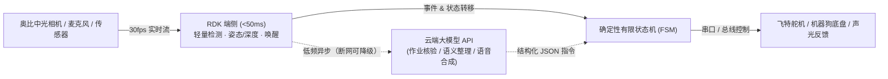

[← 返回总览雷达](../README.md) · [查看 MakeMIT 标杆拆解 →](makemit-and-benchmarks.md)

# 地瓜机器人黑客松 2026（D-Robotics Hackathon）深度调研

- **官网**：<https://hackathon.d-robotics.cc/>
- **时间**：`2026.12.05 — 12.07`（12.05 13:00 签到开赛，12.07 12:00 截止提交，14:00 评审，18:30 决赛路演与颁奖）
- **地点**：上海 · 张江科学会堂（提供免费餐饮、会期住宿与国内往返交通支持）
- **报名**：`2026.10.01 — 11.30`（`11.30` 前完成参赛确认）
- **组队**：`2–4` 人，支持个人报名后线上组队，必须线下参加
- **奖池**：`¥300,000`（MVP ¥120,000 ×1、一等奖 ¥50,000 ×1、二等奖 ¥30,000 ×2、三等奖 ¥10,000 ×5、人气奖 ¥20,000 ×1）

> [!WARNING]
> 截至 `2026-11-19`，官网报名按钮显示“报名时间加载中”，建议优先通过地瓜机器人官方公众号或合作社区推文获取真实表单入口，以免错过 `11.30` 截止线。

---

## 一、赛题本质：为什么它不是“算法刷榜赛”？

官网口号是 **`BEYOND THE SCREEN · 48H 和真实世界碰一碰`**，专家评审副标题是 **`懂机器人边界更懂越界`**。结合评委与合作伙伴构成，胜负逻辑非常明确：

1. **产品定义与商业闭环审美**：专家评委包含 **于盈**（深圳科创学院）、**钱程**（科沃斯 CEO）、**王淮**（线性资本）、小米战投等——高度看重“是否针对具体人群解决了真痛点”，而不是只跑通一个实验室 Demo。
2. **工业设计与情绪价值审美**：**贾伟 KK**（洛可可创始人）坐镇，且洛可可是**首席艺术指导单位**——装置的造型美感、拟人化反馈、交互戏剧性权重极高。
3. **传播力与 15 秒路演可视性**：首席内容合作平台是 **小红书科技**，特约直播平台是 **哔哩哔哩直播**——作品必须让观众在十几秒短视频里一眼看懂“它干了什么、为什么好玩或有用”。
4. **端侧硬件不可替代性**：**余凯**（地平线 CEO）、**王丛**（地瓜机器人 CEO）、**王田苗**——会追问 **为什么必须用 RDK 做本地计算**（低延迟闭环、隐私不出端、多传感器实时融合），而不是做个手机 App 套块板子。
5. **非传统硬件外设也在鼓励范围内**：合作伙伴不仅有机器人/机械臂/相机/舵机厂商（维他动力、宇树、松灵、求之、奥比中光、飞特），还有 **黑白调（工学椅）**、**蓝盒子（睡眠）**、**影石 Insta360**，非常欢迎桌搭、生活伴侣、创作工具等“越界”人机交互产品。

---

## 二、现场硬件与算力边界

### 1. 现场提供的硬件资源（官方页面列出，具体分配规则未公开）
- **核心计算平台（必选）**：地瓜 RDK 开发板（现场列出 `X5`、`S100`、`S600`）
- **机器人本体**：人形机器人（萝博派对、宇树）、机器狗（维他动力 Vbot EDU、宇树）
- **操作与移动**：求之 P7 / 松灵机械臂与灵巧手、四轮移动底盘
- **感知与执行**：奥比中光深度相机、飞特总线舵机/电机
- **制作与交互**：3D 打印、PCB 打样、CNC、麦克风、扬声器、屏幕、焊接测量工具
- **云与 AI 开发资源**：百度智能云（云算力支持）、Qoder & WorkBuddy（AI 开发工具与 Token 支持——属于编程辅助资源，不等于训练算力）

### 2. RDK 端侧推理现实边界与推荐架构

> [!IMPORTANT]
> 公开资料中 RDK 系列峰值 NPU 算力参考约为：`X5` 10 TOPS、`S100` 80 TOPS、`S600` 560 TOPS。**峰值 TOPS 不等于通用 GPU 能力，也不等于大语言模型流畅生成速度。** 赛前无法保证每支队伍一定分到 `S100`/`S600`，最稳的架构必须按最基础的 **`RDK X5` 能跑通**来设计：

- **RDK 端侧负责（`<50ms` 实时闭环）**：轻量视觉检测/关键点/手势姿态（YOLO / MediaPipe 级别）、深度图空间距离计算、音频唤醒/局部事件检测、确定性有限状态机（FSM）、串口/总线驱动舵机或底盘。
- **云端/外部 GPU 负责（赛前或低频异步）**：若需微调模型，在外部 GPU 训练并转换部署；多模态语义理解、内容整理等延迟可容忍环节，按需异步请求云端 API，**并保留断网本地降级逻辑**。
- **坚决避免**：在 48 小时现场让未经充分验证的大体积 VLA 或端侧 LLM 掌管实时运动控制，或在没有稳定数据闭环的情况下现场炼丹赌成功率。

---

## 三、开发与提交硬性要求
- 必须以 **地瓜 RDK 为核心计算平台**（可搭配 MCU、传感器、执行器）。
- 必须 **运用 AI 辅助开发，并展示 AI 的使用过程**（建议保留 Copilot/Qoder/WorkBuddy 对话截图、架构迭代记录、Git commit 历史）。
- 允许新项目、改造已有项目或完成未完成项目；**已有项目必须明确区分赛前基础与 48 小时活动期间新增工作**。
- 最终必须 **现场演示可运行的实物**。
